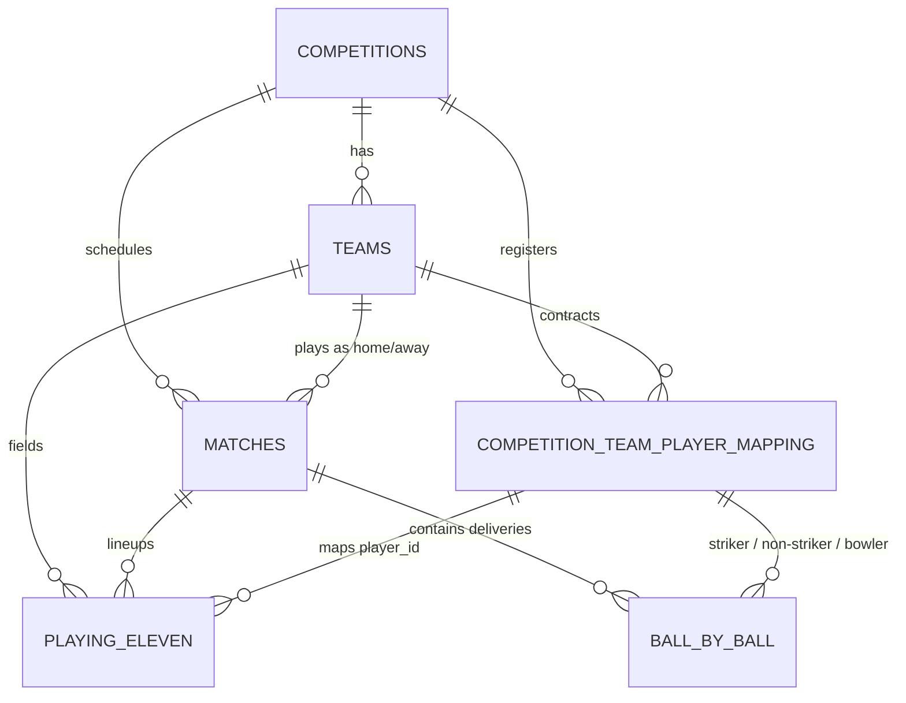

# SUPER RR — CLUTCH IQ: Data Dictionary (Updated & Validated)

This document provides the complete, field-by-field data dictionary for all six CSV files provided in `data/raw/` for the **SupeRR Selector Season 2** competition.

---

## 1. Entity-Relationship Overview

The dataset forms a relational schema centered around deliveries (`ball_by_ball.csv`) tied to matches, competitions, teams, and players.

### Key Foreign Key Connections
- `competitions.comp_id` = `matches.comp_id` = `teams.comp_id` = `competition_team_player_mapping.comp_id`
- `teams.team_id` = `matches.home_team_id` / `away_team_id` = `playing_eleven.team_id` = `ball_by_ball.batting_team_id` / `bowling_team_id`
- `matches.match_id` = `playing_eleven.match_id` = `ball_by_ball.match_id`
- `competition_team_player_mapping.player_id` = `playing_eleven.player_id` = `ball_by_ball.striker_id` / `non_striker_id` / `bowler_id` / `dismissed_player_id`

---

## 2. Table-by-Table Data Dictionary

### 2.1 `competitions.csv`
- **File size**: 7,624 bytes (0.01 MB)
- **Dimensions**: 141 rows × 4 columns
- **Primary Key**: `comp_id` (Unique: Yes)

| Column Name | Raw Dtype | Target Dtype | Null Count (%) | Description & Cricket Meaning | Allowed / Sample Values |
| :--- | :--- | :--- | :--- | :--- | :--- |
| `comp_id` | `int64` | `int32` | 0 (0.0%) | Unique competition / tournament identifier | e.g. 1358 (IPL 2022), 2725 (IPL 2025), 3395 |
| `comp_name` | `object` | `string` | 0 (0.0%) | Full competition title | e.g. "IPL 2024", "Asia Cup 2022", "England in Pakistan T20I Series 2022" |
| `match_format` | `object` | `category`| 0 (0.0%) | Match classification | 'T20I' (134 comps), 'T20' (7 comps: IPL 2022–2026, Emerging Teams) |
| `season` | `object` | `string` | 0 (0.0%) | Calendar season or multi-year season | '2022', '2022/23', '2023', '2023/24', '2024', '2024/25', '2025', '2026' |

---

### 2.2 `teams.csv`
- **File size**: 6,922 bytes (0.01 MB)
- **Dimensions**: 353 rows × 3 columns
- **Composite Primary Key**: `(comp_id, team_id)` (Unique: Yes)

| Column Name | Raw Dtype | Target Dtype | Null Count (%) | Description & Cricket Meaning | Allowed / Sample Values |
| :--- | :--- | :--- | :--- | :--- | :--- |
| `comp_id` | `int64` | `int32` | 0 (0.0%) | Competition reference | Matches `competitions.comp_id` |
| `team_id` | `int64` | `int32` | 0 (0.0%) | Unique team identifier | 38 unique teams across all rows |
| `team_name` | `object` | `string` | 0 (0.0%) | Official team name | e.g. "Rajasthan Royals", "India", "England", "Kolkata Knight Riders" |

---

### 2.3 `matches.csv`
- **File size**: 123,864 bytes (0.12 MB)
- **Dimensions**: 883 rows × 22 columns
- **Primary Key**: `match_id` (Unique: Yes)

| Column Name | Raw Dtype | Target Dtype | Null Count (%) | Description & Cricket Meaning | Allowed / Sample Values |
| :--- | :--- | :--- | :--- | :--- | :--- |
| `match_id` | `int64` | `int32` | 0 (0.0%) | Unique match identifier | 883 unique matches |
| `comp_id` | `int64` | `int32` | 0 (0.0%) | Foreign key to competition | All 883 match `comp_id` values exist in `competitions.csv` |
| `match_number`| `int64` | `int16` | 0 (0.0%) | Match sequence number in competition | e.g. 1 to 74 |
| `match_date` | `object` | `datetime64[ns]`| 0 (0.0%) | Date match was played (YYYY-MM-DD) | '2022-01-22' to '2026-11-08' |
| `stage` | `object` | `category`| 0 (0.0%) | Tournament phase | 'League' (620), 'Others' (226), 'Final' (12), 'Qualifier' (10), 'Super 4' (6), 'Eliminator' (5), 'Semi Final' (4) |
| `venue_id` | `int64` | `int32` | 0 (0.0%) | Unique stadium / ground ID | e.g. 54, 71, 98 |
| `venue_country`| `object`| `string` | 0 (0.0%) | Country where stadium is located | e.g. "India", "West Indies", "Australia", "United Arab Emirates" |
| `home_team_id`| `int64` | `int32` | 0 (0.0%) | Designated home team ID | References `teams.team_id` |
| `home_team` | `object` | `string` | 0 (0.0%) | Designated home team name | Matches `teams.team_name` |
| `away_team_id`| `int64` | `int32` | 0 (0.0%) | Designated away team ID | References `teams.team_id` |
| `away_team` | `object` | `string` | 0 (0.0%) | Designated away team name | Matches `teams.team_name` |
| `home_team_captain_id` | `float64` | `Int32` | 44 (5.0%) | Player ID of home captain | Missing in 44 abandoned/early matches |
| `away_team_captain_id` | `float64` | `Int32` | 45 (5.1%) | Player ID of away captain | Missing in 45 matches |
| `toss_win_team_id` | `float64` | `Int32` | 15 (1.7%) | Team ID winning the coin toss | Missing in 15 matches with no toss conducted |
| `toss_opted` | `object` | `category`| 15 (1.7%) | Decision made at toss | 'Batting', 'Fielding' |
| `man_of_the_match` | `int64` | `Int32` | 0 (0.0%) | Player ID awarded POTM | 0 when not awarded or abandoned |
| **`first_inn_revised_overs`**| `float64`| `float32` | 858 (97.2%) | **Revised legal BALLS allocated (NOT overs!)** | **Multiples of 6 (e.g. 48.0 = 8 overs, 90.0 = 15 overs). Present in 25 matches** |
| **`second_inn_revised_overs`**| `float64`| `float32`| 858 (97.2%) | **Revised legal BALLS allocated (NOT overs!)** | **Multiples of 6 (e.g. 30.0 = 5 overs, 90.0 = 15 overs). Present in 25 matches** |
| `revised_target` | `float64` | `Int32` | 860 (97.4%) | Target score set by DLS method | e.g. 171, 142, 66 (Present in 23 matches) |
| `knock_out` | `int64` | `int8` | 0 (0.0%) | Flag: 1 if knockout/playoff, 0 if regular | 1 (31 matches), 0 (852 matches) |
| `win_team_id` | `float64` | `Int32` | 41 (4.6%) | Winning team ID | Null in 41 abandoned / no-result / tied matches |
| `result` | `object` | `string` | 0 (0.0%) | Full text result summary | e.g. "Rajasthan Royals Won by 23 Runs", "Match Abandoned" |

---

### 2.4 `competition_team_player_mapping.csv`
- **File size**: 462,969 bytes (0.44 MB)
- **Dimensions**: 6,413 rows × 6 columns
- **Composite Key**: `(comp_id, team_id, player_id)`

| Column Name | Raw Dtype | Target Dtype | Null Count (%) | Description & Cricket Meaning | Allowed / Sample Values |
| :--- | :--- | :--- | :--- | :--- | :--- |
| `comp_id` | `int64` | `int32` | 0 (0.0%) | Competition ID | Foreign key to `competitions.comp_id` |
| `comp_name` | `object` | `string` | 0 (0.0%) | Competition Name | Redundant copy of competition name |
| `team_id` | `int64` | `int32` | 0 (0.0%) | Team ID | Foreign key to `teams.team_id` |
| `team_name` | `object` | `string` | 0 (0.0%) | Team Name | Redundant copy of team name |
| `player_id` | `int64` | `int32` | 0 (0.0%) | Unique Player ID | 1,217 unique players |
| `player_name` | `object` | `string` | 0 (0.0%) | Player full name | 1,210 unique names (7 names shared by multiple IDs) |

> [!WARNING]
> **Name Collision Hazard**: Exactly 7 player names map to multiple player IDs (e.g., `Abdul Samad` has IDs 7446 and 6922; `Haider Ali` has IDs 7338 and 28756; `Basil Hameed` has IDs 8638 and 39444).
> **Rule**: All aggregations and joins MUST use `player_id`, never `player_name`.

---

### 2.5 `playing_eleven.csv`
- **File size**: 966,287 bytes (0.92 MB)
- **Dimensions**: 28,381 rows × 9 columns
- **Duplicate Note**: 75 rows in 3 matches (13613, 21176, 28962) contain duplicate `(match_id, player_id)` pairs due to conflicting preliminary lineup card versions differing only in `batting_order`.

| Column Name | Raw Dtype | Target Dtype | Null Count (%) | Description & Cricket Meaning | Allowed / Sample Values |
| :--- | :--- | :--- | :--- | :--- | :--- |
| `match_id` | `int64` | `int32` | 0 (0.0%) | Match ID | References `matches.match_id` (880 matches present) |
| `team_id` | `int64` | `int32` | 0 (0.0%) | Team ID | References `teams.team_id` |
| `player_id` | `int64` | `int32` | 0 (0.0%) | Player ID | References `competition_team_player_mapping.player_id` |
| `batting_order`| `float64`| `Int8` | 8,678 (30.6%) | Batting position on team sheet | 1.0 to 11.0 (Null for benched players) |
| `is_played` | `bool` | `bool` | 0 (0.0%) | Flag: Played in match XI | `True` (19,714), `False` (8,667 benched/subs) |
| `is_captain` | `object` | `boolean` | 8,667 (30.5%) | Flag: Match captain | `True`, `False`, or Null (for benched) |
| `is_wk` | `object` | `boolean` | 8,667 (30.5%) | Flag: Designated wicketkeeper | `True`, `False`, or Null (for benched) |
| `is_impact` | `int64` | `int8` | 0 (0.0%) | Flag: Substituted in as Impact Player | `1` (558), `0` (27,823) |
| `is_impact_off`| `int64` | `int8` | 0 (0.0%) | Flag: Substituted out as Impact Player | `1` (558), `0` (27,823) |

---

### 2.6 `ball_by_ball.csv`
- **File size**: 41,071,609 bytes (39.17 MB)
- **Dimensions**: 200,999 rows × 33 columns
- **Primary Key**: `(match_id, innings, innings_ball_num)` (Unique: Yes)

| Column Name | Raw Dtype | Target Dtype | Null Count (%) | Description & Nuance | Allowed / Sample Values |
| :--- | :--- | :--- | :--- | :--- | :--- |
| `match_id` | `int64` | `int32` | 0 (0.0%) | Foreign key to `matches.match_id` | 867 unique matches |
| `innings` | `int64` | `int8` | 0 (0.0%) | Innings number | 1 (1st inn: 105,727), 2 (2nd inn: 95,234), 3 (Super Over 1: 25), 4 (Super Over 2: 13) |
| `overid` | `int64` | `int8` | 0 (0.0%) | Over number (1-indexed!) | 1 to 20. Over 1 is `overid=1`. Primary Death Overs = 16–20; Stricter Death = 17–20 |
| `over_ball_num`| `int64` | `int8` | 0 (0.0%) | **Sequential delivery counter in over (NOT legal ball count!)** | 1 to 9+ (Increments on extras; illegal deliveries cause over to reach > 6) |
| `innings_ball_num`| `int64` | `int16` | 0 (0.0%) | Sequential delivery count in innings | 1 to 135+ |
| `batting_team_id`| `int64` | `int32` | 0 (0.0%) | Team batting | References `teams.team_id` |
| `bowling_team_id`| `int64` | `int32` | 0 (0.0%) | Team bowling | References `teams.team_id` |
| `striker_id` | `int64` | `int32` | 0 (0.0%) | Batter facing the ball | References player mapping |
| `striker_name` | `object` | `string` | 0 (0.0%) | Batter facing name | e.g. "Rinku Singh", "Sanju Samson" |
| `non_striker_id`| `int64` | `int32` | 0 (0.0%) | Batter at non-striker end | References player mapping |
| `non_striker_name`| `object`| `string` | 0 (0.0%) | Non-striker name | e.g. "Jos Buttler" |
| `bowler_id` | `int64` | `int32` | 0 (0.0%) | Bowler delivering the ball | References player mapping |
| `bowler_name` | `object` | `string` | 0 (0.0%) | Bowler name | e.g. "Jasprit Bumrah", "Arshdeep Singh" |
| `batting_type` | `object` | `category`| 0 (0.0%) | Batter stance | 'RHB' (Right Hand Bat), 'LHB' (Left Hand Bat) |
| `bowling_type` | `object` | `category`| 0 (0.0%) | Bowler classification | 'Right-arm fast', 'Slow left-arm orthodox', 'Legbreak googly', etc. |
| `batting_order`| `int64` | `int8` | 0 (0.0%) | Actual position batter came in | 1 to 11 |
| `runs` | `int64` | `int8` | 0 (0.0%) | **Runs scored off the bat by striker** | 0, 1, 2, 3, 4, 5, 6 (Always 0 on wides, byes, legbyes) |
| `is_four` | `bool` | `bool` | 0 (0.0%) | Flag: Boundary four off the bat | True / False |
| `is_six` | `bool` | `bool` | 0 (0.0%) | Flag: Boundary six off the bat | True / False |
| `is_wicket` | `bool` | `bool` | 0 (0.0%) | Flag: Wicket fell on delivery | True (10,881), False (190,118) |
| `dismissal_type_id`| `float64`| `Int8` | 190,118 (94.6%)| Numeric dismissal type code | 1.0 to 10.0 |
| `dismissal_type`| `object` | `category`| 190,118 (94.6%)| Dismissal type description | 'Caught' (7,557), 'Bowled' (1,775), 'LBW' (709), 'RunOut' (600), 'Stump' (214), 'Hit Wicket' (17), 'Retire Out' (6), 'Obstructing the field' (1), 'Obstracting the field' (2) |
| `dismissed_player_id`| `float64`| `Int32`| 190,107 (94.6%)| ID of the batsman out | Striker in 10,606 dismissals; Non-striker in 274 dismissals; 1 row resolved to Tilak Varma (7897) |
| `extras_type` | `object` | `category`| 189,167 (94.1%)| Extra classification | 'wide' (7,714), 'legbyes' (2,748), 'Overstep' (576), 'byes' (529), 'other' (264), 'Penalty' (1) |
| **`extras1_runs`** | `int64` | `int8` | 0 (0.0%) | **DECODED: Extra Type ID Code (NOT runs!)** | **1=Overstep, 2=wide, 3=legbyes, 4=byes, 5=other, 6=None, 7=Penalty** |
| `extras_2_runs` | `int64` | `int8` | 0 (0.0%) | Extra boundary runs on no-balls/other | 0 (200,963), 1 (20), 4 (16). Excluded from bowler runs conceded. |
| `pace_or_spin` | `object` | `category`| 0 (0.0%) | Bowling discipline | 'Pace' (123,886), 'Spin' (77,113) |
| `bowl_speed` | `float64` | `float32` | 0 (0.0%) | Speed gun reading (km/h) | **Unreliable**: 38.7% are 0.0 or -1.0; extreme glitches up to 1456.1. Excluded from ranking models. |
| `stroke` | `object` | `category`| 6,158 (3.1%) | Shot played | 'Cover Drive', 'Flick', 'Slog', 'Pull shot', etc. |
| `delivery_style`| `object` | `category`| 391 (0.2%) | Ball movement style | 'Inswing', 'Outswing', 'Off-break', etc. |
| `over_or_around`| `object` | `category`| 407 (0.2%) | Bowling angle | 'Over', 'Around' |
| `on_or_off` | `object` | `category`| 0 (0.0%) | Field placement orientation | 'Off-side', 'On-side' |
| `delivery_ist_time`| `object`| `datetime64[ns]`| 0 (0.0%)| Timestamp of delivery | e.g. '2022-01-23 00:00:00 UTC' |

---

## 3. Summary of Governing Analytical Rules

1. **Bowler Runs Conceded**: `runs + (1 if wide else 0) + (1 if Overstep or other else 0)`. Byes, leg-byes, and `extras_2_runs` are excluded.
2. **Bowler Wickets**: Strictly `['Bowled', 'Caught', 'LBW', 'Stump', 'Hit Wicket']`. RunOut, Retire Out, and Obstructing are excluded.
3. **Legal Deliveries**: `extras_type not in ['wide', 'Overstep', 'other']`. `over_ball_num` is NOT used as legal ball count.
4. **Batter Dismissals**: Counted via `dismissed_player_id == player_id`. Captures all striker dismissals and 274 non-striker run-outs.
5. **Super Overs**: Filtered out of regular innings via `innings <= 2`. Preserved separately with `is_super_over = innings >= 3`.
6. **Revised Overs**: Column values are legal balls. Actual overs = `revised_balls / 6.0`.
