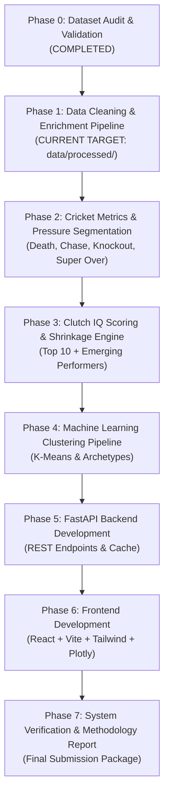

# SUPER RR — CLUTCH IQ: Phased Development Roadmap (Updated)

This document outlines the step-by-step engineering roadmap for building the **SUPER RR — CLUTCH IQ** analytics web application and finalizing the **SupeRR Selector Season 2** competition submission.

---

## Roadmap Overview & Phases

---

## Phase Details & Verification Gates

### Phase 0: Dataset Audit & Additional Validation (COMPLETED)
- **Status**: Completed & Validated.
- **Key Deliverables**:
  - `docs/PROJECT_REQUIREMENTS.md`
  - `docs/DATA_DICTIONARY.md` (Updated with balls vs overs, extras decode, duplicate cleanup)
  - `docs/DATA_AUDIT.md` (Updated with 10 validation investigations)
  - `docs/TECHNICAL_ARCHITECTURE.md` (Updated with user decisions, zero outcome leakage)
  - `docs/DEVELOPMENT_ROADMAP.md`
- **Verification Gate**:
  - [x] All 10 validation points programmatically proven.
  - [x] User decisions integrated (Overs 16–20 primary / 17–20 strict; 50-ball qualification + emerging tier; situational chase without outcome leakage).

---

### Phase 1: Data Cleaning & Enrichment Pipeline (CURRENT TARGET)
- **Goal**: Build a deterministic, reproducible ETL pipeline that transforms raw CSVs into clean, enriched Parquet tables in `data/processed/` with extensive data-quality logging and validation tests.
- **Tasks**:
  1. Create `backend/etl/clean_data.py`.
  2. Implement data hygiene:
     - Deduplicate 75 preliminary lineup rows in `playing_eleven.csv`.
     - Decode `dismissed_player_id` anomaly on row 127899 (Tilak Varma, 7897).
     - Standardize text and dismissal types (normalize `Obstracting the field` -> `Obstructing the field`).
     - Convert revised overs from balls to actual overs (`revised_overs = revised_balls / 6.0`).
  3. Feature enrichment on deliveries:
     - `is_legal_ball = ~extras_type.isin(['wide', 'Overstep', 'other'])`.
     - `bowler_runs = runs + (1 if wide) + (1 if Overstep or other)`. (Excluding byes, leg-byes, and `extras_2_runs`).
     - `is_bowler_wicket = is_wicket & dismissal_type.isin(['Bowled', 'Caught', 'LBW', 'Stump', 'Hit Wicket'])`.
     - `is_batter_out = dismissed_player_id == player_id`.
     - `phase`: 'Powerplay' (overs 1–6), 'Middle' (overs 7–15), 'Death_Primary' (overs 16–20), 'Death_Strict' (overs 17–20).
     - `is_super_over = innings >= 3`.
     - `is_knockout = matches.knock_out == 1`.
  4. Situational Chase Enrichment (Zero Outcome Leakage):
     - Calculate cumulative innings runs and target score (1st innings total + 1, or `revised_target`).
     - Calculate `legal_balls_bowled_in_innings` and `legal_balls_remaining = total_allotted_balls - legal_balls_bowled`.
     - Calculate live `required_run_rate` at every delivery in Innings 2.
     - Add boolean flag: `is_situational_close_chase = (innings == 2) & (legal_balls_remaining <= 36) & (required_run_rate >= 9.0)`.
  5. Post-Hoc Match Margin Enrichment (for secondary exploratory analysis only):
     - `is_close_margin_match`: Flag for matches won by $\le 15$ runs or $\le 3$ wickets.
  6. Export cleaned datasets:
     - `data/processed/clean_deliveries.parquet`
     - `data/processed/clean_matches.parquet`
     - `data/processed/clean_players.parquet`
  7. Implement validation test script:
     - `backend/tests/test_data_pipeline.py`.
- **Verification Gate**:
  - Total deliveries = 200,999.
  - Bowler wickets = 10,272.
  - Legal balls + illegal deliveries = 200,999.
  - Super Overs cleanly tagged (`is_super_over == True` for exactly 38 deliveries).
  - All automated validation tests pass.

---

### Phase 2: Cricket Metrics & Pressure Segmentation (Next Step)
- **Goal**: Calculate baseline and pressure performance metrics across the 3 pressure categories for all players.
- **Stop Instruction**: Do not proceed until Phase 1 pipeline is reviewed and approved.

---

### Phase 3: Clutch IQ Scoring Model & Statistical Reliability
- Primary Top 10 Leaderboard (minimum 50 pressure balls).
- Emerging Clutch Performers tier ($< 50$ pressure balls).
- Bayesian shrinkage with match breadth weighting ($N_i \cdot \sqrt{M_i}$).

---

### Phase 4: Machine Learning Clustering Pipeline
- K-Means clustering on multidimensional pressure features.
- Elbow and Silhouette score evaluation.
- PCA for 2D/3D Plotly visual rendering.

---

### Phase 5: FastAPI Backend Development
- High-performance REST endpoints with Parquet caching.

---

### Phase 6: React + Vite + Tailwind CSS Frontend Development
- Interactive Rajasthan Royals themed dashboard, Leaderboard, Plotly Radar charts, Cluster scatter plot, and Head-to-Head tool.

---

### Phase 7: Verification, Methodology Report Export & Submission
- Final validation against Unstop dropdown names, export methodology report, and produce run scripts.
