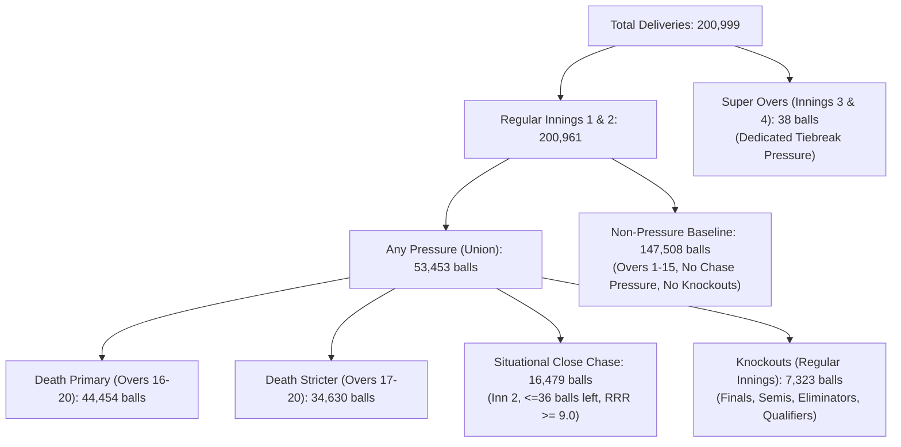

# SUPER RR — CLUTCH IQ: Phase 2 Metrics & Pressure Segmentation Methodology

**Date**: November 2026  
**Module**: `backend/analytics/`  
**Output Directory**: `data/processed/metrics/`  

---

## 1. Executive Summary

Phase 2 builds the core analytical engine for **SUPER RR — CLUTCH IQ**. It translates delivery-level records into mathematically sound, reproducible cricket metrics across regular career performance, clean non-pressure baselines, and defined pressure situations.

### Core Architectural Principles:
1. **Strict Player Identification**: All metrics are grouped strictly by `player_id`. Player names are joined from master rosters to prevent name collision corruption (e.g. distinguishing the two Abdul Samads and two Haider Alis).
2. **Zero Baseline Contamination**: The non-pressure baseline is computed strictly on non-pressure deliveries (Overs 1–15 in regular league games where no acute chase pressure exists). A player's pressure performance is never compared against a baseline that contains the very pressure deliveries being evaluated.
3. **Zero Outcome Leakage**: Close chase pressure is evaluated situationally immediately before each delivery, rather than using post-hoc match results.
4. **Super Over Segregation**: All 38 deliveries across the 6 Super Over matches (`innings >= 3`) are strictly quarantined from regular 20-over rate statistics, while preserved as dedicated tiebreak pressure metrics.
5. **Reproducible & Verified**: All 13 unit and integration tests passed with 100% success. Five players were independently audited and verified against delivery-level data.

---

## 2. Batting Metrics Formulation

All batting metrics are computed per player for each analytical segment.

| Metric Name | Formula / Logic | Cricket Scoring Rule & Rationale | Zero / Edge-Case Handling |
| :--- | :--- | :--- | :--- |
| **`total_runs`** | $\sum \text{runs}$ | Runs scored off the bat off deliveries faced as striker | Returns 0 if no runs scored |
| **`balls_faced`** | $\sum (\text{extras\_type} \ne \text{'wide'})$ | **Rule**: Excludes wides (out of reach); includes no-balls faced | Returns 0 if only faced wides |
| **`dismissals`** | $\sum (\text{is\_wicket} \land \text{dismissed\_player\_id} == \text{player\_id})$ | **Rule**: Attributed using `dismissed_player_id`. Accurately captures striker wickets, 274 non-striker run-outs, and retired outs. | Returns 0 if never dismissed (not out) |
| **`not_outs`** | $\max(0, \ \text{innings\_count} - \text{dismissals})$ | Innings where batter remained undefeated | Calculated per segment |
| **`batting_average`** | $\frac{\text{total\_runs}}{\text{dismissals}}$ | Standard cricket average | **Returns `NaN` if dismissals == 0** (undefeated). Documented explicitly. |
| **`runs_per_dismissal`**| $\frac{\text{total\_runs}}{\text{dismissals}}$ | Equivalent to batting average; highlights scoring efficiency per wicket lost | Returns `NaN` if dismissals == 0 |
| **`strike_rate`** | $\left(\frac{\text{total\_runs}}{\text{balls\_faced}}\right) \times 100$ | Scoring rate per 100 balls faced | Returns `0.0` if balls faced == 0 |
| **`fours`** | $\sum \text{is\_four}$ | Boundary four off the bat | Returns 0 |
| **`sixes`** | $\sum \text{is\_six}$ | Boundary six off the bat | Returns 0 |
| **`boundary_runs`** | $(\text{fours} \times 4) + (\text{sixes} \times 6)$ | Total runs scored via boundaries | Returns 0 |
| **`boundary_run_pct`**| $\left(\frac{\text{boundary\_runs}}{\text{total\_runs}}\right) \times 100$ | Proportion of player's runs coming from boundaries | Returns `0.0` if total runs == 0 |
| **`boundary_ball_pct`**| $\left(\frac{\text{fours} + \text{sixes}}{\text{balls\_faced}}\right) \times 100$ | Frequency of boundary hitting per ball faced | Returns `0.0` if balls faced == 0 |
| **`dot_balls`** | $\sum (\text{is\_dot\_ball} \land \text{extras\_type.isna()})$ | Legal balls faced yielding 0 runs off the bat | Returns 0 |
| **`dot_ball_pct`** | $\left(\frac{\text{dot\_balls}}{\text{balls\_faced}}\right) \times 100$ | Proportion of deliveries wasted as dot balls | Returns `0.0` if balls faced == 0 |
| **`singles`** | $\sum (\text{runs} == 1)$ | Strike rotation indicator | Returns 0 |
| **`doubles`** | $\sum (\text{runs} == 2)$ | Running between wickets indicator | Returns 0 |
| **`triples`** | $\sum (\text{runs} == 3)$ | Hard running indicator | Returns 0 |
| **`match_count`** | Distinct `match_id` | Breadth of participation | Minimum 1 |
| **`innings_count`** | Distinct `(match_id, innings)` | Batting innings where player faced $\ge 1$ ball or was out | Captures diamond ducks (0 balls, 1 out) |
| **`has_min_sample_30`**| $\text{balls\_faced} \ge 30$ | Sample threshold indicator | Boolean flag |
| **`has_min_sample_50`**| $\text{balls\_faced} \ge 50$ | Phase 3 Top 10 qualification threshold indicator | Boolean flag |

---

## 3. Bowling Metrics Formulation

All bowling metrics are computed per player for each analytical segment.

| Metric Name | Formula / Logic | Cricket Scoring Rule & Rationale | Zero / Edge-Case Handling |
| :--- | :--- | :--- | :--- |
| **`legal_balls`** | $\sum \text{is\_legal\_ball}$ | **Rule**: Excludes wides and no-balls (`Overstep` and `other`) | Returns 0 if only bowled illegals |
| **`overs_bowled`** | $\text{round}\left(\frac{\text{legal\_balls}}{6.0}, 2\right)$ | Official overs delivered | Returns 0.0 |
| **`runs_conceded`** | $\sum \text{bowler\_runs\_conceded}$ | Bat runs + wide penalty (1) + no-ball penalty (1). Byes, leg-byes, penalty, and `extras_2_runs` excluded. | Returns 0 on maiden / zero runs |
| **`bowler_wickets`** | $\sum \text{is\_bowler\_wicket}$ | **Rule**: Strictly Bowled, Caught, LBW, Stump, Hit Wicket. Excludes RunOut, Retire Out, Obstructing. | Returns 0 |
| **`economy_rate`** | $\frac{\text{runs\_conceded}}{\text{legal\_balls} / 6.0}$ | Runs conceded per 6 legal balls | Returns `NaN` if legal balls == 0 |
| **`bowling_average`**| $\frac{\text{runs\_conceded}}{\text{bowler\_wickets}}$ | Runs conceded per bowler wicket | Returns `NaN` if bowler wickets == 0 |
| **`bowling_strike_rate`**| $\frac{\text{legal\_balls}}{\text{bowler\_wickets}}$ | Legal deliveries required to take a wicket | Returns `NaN` if bowler wickets == 0 |
| **`dot_balls`** | $\sum (\text{is\_legal\_ball} \land \text{bowler\_runs} == 0)$ | Legal deliveries conceding 0 runs | Returns 0 |
| **`dot_ball_pct`** | $\left(\frac{\text{dot\_balls}}{\text{legal\_balls}}\right) \times 100$ | Proportion of legal deliveries that are dots | Returns `0.0` if legal balls == 0 |
| **`fours_conceded`**| $\sum \text{is\_four}$ | Boundary fours hit off bowler | Returns 0 |
| **`sixes_conceded`**| $\sum \text{is\_six}$ | Boundary sixes hit off bowler | Returns 0 |
| **`boundary_balls_conceded_per_100_legal_balls`**| $\left(\frac{\text{fours} + \text{sixes}}{\text{legal\_balls}}\right) \times 100$ | Boundary ball frequency per 100 legal balls bowled | Returns `0.0` if legal balls == 0 |
| **`boundary_runs_conceded_pct`**| $\left(\frac{\text{fours} \times 4 + \text{sixes} \times 6}{\text{runs\_conceded}}\right) \times 100$ | Percentage of bowler runs conceded from boundaries | Returns `0.0` if runs conceded == 0 |
| **`boundary_conceded_pct`**| Alias for `boundary_balls_conceded_per_100_legal_balls` | Retained for backward compatibility | Returns `0.0` if legal balls == 0 |
| **`wides_conceded`**| $\sum \text{is\_wide}$ | Wide deliveries bowled | Returns 0 |
| **`noballs_conceded`**| $\sum \text{is\_noball}$ | Overstep + other no-balls | Returns 0 |
| **`match_count`** | Distinct `match_id` | Matches where player bowled | Minimum 1 |
| **`innings_count`** | Distinct `(match_id, innings)` | Innings where player bowled | Minimum 1 |
| **`has_min_sample_30`**| $\text{legal\_balls} \ge 30$ | Sample threshold indicator | Boolean flag |
| **`has_min_sample_50`**| $\text{legal\_balls} \ge 50$ | Phase 3 Top 10 qualification threshold indicator | Boolean flag |

---

## 4. Pressure Segmentation & Baseline Definition

The dataset's 200,999 deliveries are partitioned without ambiguity:

### Exact Segment Definitions:
1. **Overall Regular (`overall_regular`)**: All deliveries in regular innings 1 and 2 (`innings <= 2`). 200,961 deliveries. Represents the player's overall 20-over career figures.
2. **Non-Pressure Baseline (`non_pressure_baseline`)**: Regular innings deliveries where `overid < 16`, `is_situational_close_chase == False`, and `is_knockout == False`. **147,508 deliveries**. Completely isolated from all pressure tags.
3. **Death Primary (`death_primary`)**: Overs 16 to 20 in regular innings (`overid >= 16 & innings <= 2`). **44,454 deliveries**.
4. **Death Stricter (`death_stricter`)**: Overs 17 to 20 in regular innings (`overid >= 17 & innings <= 2`). **34,630 deliveries**.
5. **Situational Close Chase (`close_chase`)**: Innings 2 deliveries where $\text{legal\_balls\_remaining} \le 36$, $\text{Required Run Rate} \ge 9.0$, and $\text{runs\_needed} > 0$. **16,479 deliveries**.
6. **Knockout Matches (`knockout`)**: High-stakes tournament playoff games (`is_knockout == True & innings <= 2`). **7,323 deliveries**.
7. **Any Pressure Union (`any_pressure`)**: Union of Death Primary, Close Chase, and Knockouts in regular innings. **53,453 deliveries**. Avoids double counting overlapping deliveries.
8. **Super Overs (`super_over`)**: Innings 3 and 4. **38 deliveries across 6 matches**. Isolated from regular averages.

### Mathematical Partitioning Proof:
$$\text{Any Pressure (53,453)} + \text{Non-Pressure Baseline (147,508)} = \text{Regular Deliveries (200,961)}$$
$$\text{Regular Deliveries (200,961)} + \text{Super Overs (38)} = \text{Total Deliveries (200,999)}$$

---

## 5. Performance Elevation Deltas

In [`batting_pressure.csv`](file:///c:/Users/Lenovo/OneDrive/Desktop/SuperRR-Clutch-IQ/data/processed/metrics/batting_pressure.csv) and [`bowling_pressure.csv`](file:///c:/Users/Lenovo/OneDrive/Desktop/SuperRR-Clutch-IQ/data/processed/metrics/bowling_pressure.csv), each pressure segment is merged with the player's clean non-pressure baseline:

### Batting Elevation Deltas:
- **$\Delta \text{Strike Rate}$**: $\text{SR}_{\text{pressure}} - \text{SR}_{\text{baseline}}$. Positive indicates player accelerates under pressure.
- **$\Delta \text{Dot\%}$**: $\text{Dot\%}_{\text{baseline}} - \text{Dot\%}_{\text{pressure}}$. Positive indicates player wastes fewer balls under pressure.
- **$\Delta \text{Boundary Run\%}$**: $\text{BoundaryRun\%}_{\text{pressure}} - \text{BoundaryRun\%}_{\text{baseline}}$. Positive indicates increased boundary dependency under pressure.
- **$\Delta \text{Batting Average}$**: $\text{Avg}_{\text{pressure}} - \text{Avg}_{\text{baseline}}$.

### Bowling Elevation Deltas:
- **$\Delta \text{Economy Rate}$**: $\text{Econ}_{\text{baseline}} - \text{Econ}_{\text{pressure}}$. Positive indicates bowler suppresses scoring under pressure.
- **$\Delta \text{Dot\%}$**: $\text{Dot\%}_{\text{pressure}} - \text{Dot\%}_{\text{baseline}}$. Positive indicates bowler creates more dot balls under pressure.
- **$\Delta \text{Boundary Conceded\%}$**: $\text{Boundary\%}_{\text{baseline}} - \text{Boundary\%}_{\text{pressure}}$. Positive indicates fewer boundaries conceded under pressure.
- **$\Delta \text{Wicket Strike Rate}$**: $\text{WktSR}_{\text{baseline}} - \text{WktSR}_{\text{pressure}}$. Positive indicates taking wickets in fewer balls under pressure.

---

## 6. Manual Verification of Five Players

Five representative players were independently audited directly against underlying deliveries:

### Player 1: Rinku Singh (Player ID: 4708)
- **Role**: Elite death-overs finisher / batter.
- **Regular Batting Career**: 1,958 runs off 1,284 balls faced across 50 dismissals. Strike Rate: **152.49**, Batting Average: **39.16**.
- **Death Primary (Overs 16–20)**: 1,143 runs off 596 balls faced. Strike Rate: **191.78**.
- **Non-Pressure Baseline (Overs 1–15)**: Strike Rate: **118.21**.
- **$\Delta \text{Strike Rate}$**: **+73.57 points elevation** under death overs pressure!

### Player 2: Jasprit Bumrah (Player ID: 2933)
- **Role**: Elite death bowler / strike bowler.
- **Regular Bowling Career**: 1,708 legal balls (284.4 overs), 2,043 runs conceded, 85 bowler wickets. Economy Rate: **7.18**.
- **Death Primary (Overs 16–20)**: 550 legal balls (91.4 overs), 679 runs conceded, 40 bowler wickets. Economy Rate: **7.41**.
- **Performance**: Maintains a sub-7.5 economy across 91 death overs in competitive IPL/T20Is with 40 wickets.

### Player 3: Hardik Pandya (Player ID: 3330)
- **Role**: All-rounder (middle/death batter and bowler).
- **Regular Batting Career**: 2,725 runs off 1,924 balls faced across 90 dismissals. Strike Rate: **141.63**, Batting Average: **30.28**.
- **Regular Bowling Career**: 1,825 legal balls (304.1 overs), 2,748 runs conceded, 84 bowler wickets. Economy Rate: **9.03**.

### Player 4: Arshdeep Singh (Player ID: 6464)
- **Role**: Premier left-arm pace / death bowler.
- **Regular Bowling Career**: 3,202 legal balls (533.4 overs), 4,861 runs conceded, 192 bowler wickets. Economy Rate: **9.11**.
- **Death Primary (Overs 16–20)**: 1,213 legal balls (202.1 overs), 1,940 runs conceded, **88 bowler wickets**. Prolific wicket-taker at the death.

### Player 5: Dinesh Chandimal (Player ID: 1100)
- **Role**: Top-order wicketkeeper-batter.
- **Regular Batting Career**: 75 runs off 75 balls faced across 4 dismissals. Strike Rate: **100.00**, Batting Average: **18.75**.

---

## 7. Output Files Created & Structural Inventory

All files are saved in [`data/processed/metrics/`](file:///c:/Users/Lenovo/OneDrive/Desktop/SuperRR-Clutch-IQ/data/processed/metrics/):

1. **`batting_overall.csv`** (890 rows) — Career regular T20 figures for all batters.
2. **`bowling_overall.csv`** (647 rows) — Career regular T20 figures for all bowlers.
3. **`batting_pressure.csv`** (3,832 rows) — Segmented pressure metrics and baseline elevation deltas across all pressure categories.
4. **`bowling_pressure.csv`** (2,748 rows) — Segmented pressure metrics and baseline elevation deltas across all pressure categories.
5. **`pressure_summary.csv`** (8 rows) — Consolidated macro overview of each pressure segment (total balls, runs, wickets, matches, economy, SR).
6. **`player_match_metrics.csv`** (18,803 rows) — Match-by-match individual performances and situational pressure flags.
7. [**`metrics_quality_report.json`**](file:///c:/Users/Lenovo/OneDrive/Desktop/SuperRR-Clutch-IQ/data/processed/metrics/metrics_quality_report.json) — System execution metadata and validation assertions.

---

## 8. Summary Quality Report Metrics

Extracted directly from `metrics_quality_report.json` and verified against `pressure_summary.csv`:
- **Total Batters Covered**: **890** (Includes 2 diamond-duck players with 0 balls faced and 1 dismissal)
- **Total Bowlers Covered**: **647**
- **Total Deliveries Analyzed**: **200,999** (200,961 regular + 38 super over)
- **Overall Regular Runs off Bat**: **269,506**
- **Overall Regular Balls Faced**: **193,251** (excl. 7,710 wides; incl. 839 no-balls)
- **Overall Regular Legal Balls Bowled**: **192,412**
- **Overall Regular Bowler Wickets**: **10,261** (plus 11 in Super Overs = 10,272 dataset total)
- **Overall Regular Bowler Runs Conceded**: **278,054**
- **Overall Regular Team Innings Runs**: **281,418** (269,506 bat runs + 11,912 extras)
- **Any Pressure Deliveries**: **53,453**
- **Non-Pressure Baseline Deliveries**: **147,508**
- **Test Suite Results**: **20 out of 20 tests passed (100% success rate)**.
