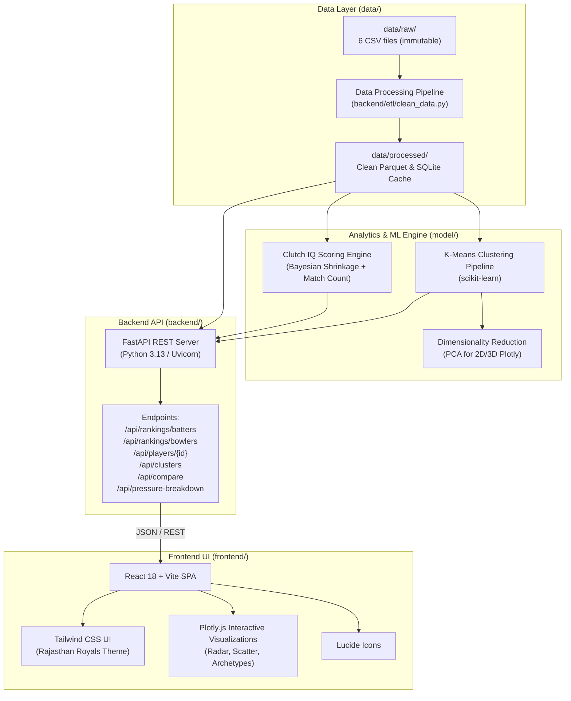
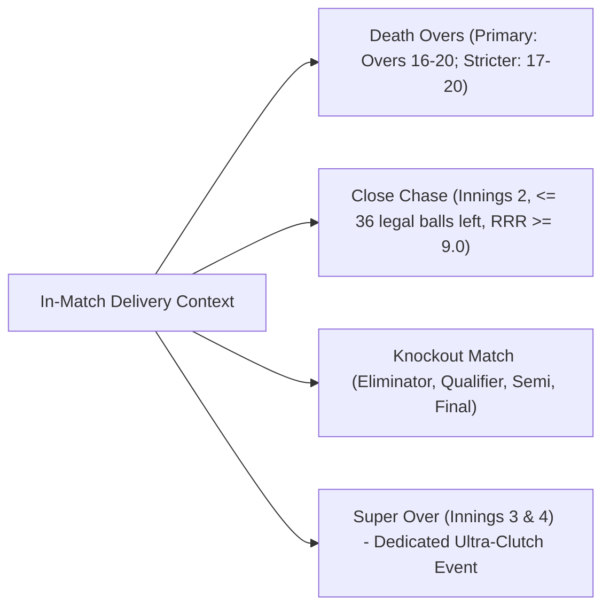

# SUPER RR — CLUTCH IQ: Technical Architecture (Updated & Validated)

## 1. System Architecture Overview

**SUPER RR — CLUTCH IQ** is designed as a decoupled, modern, responsive full-stack analytics platform built with 100% free, open-source technologies.

---

## 2. User Decisions & Design Directives

Following the Phase 0 audit review, the architecture adopts the following three validated directives:

1. **Death Overs Definition**:
   - **Primary Analysis**: Overs 16 to 20 (`overid >= 16`). Covers the standard final 5 death overs.
   - **Stricter Analysis**: Overs 17 to 20 (`overid >= 17`). Supported as an optional toggle for deeper pressure isolation.
2. **Sample Size & Qualification**:
   - **Primary Leaderboard Qualification**: Minimum **50 pressure balls** (faced for batters, bowled for bowlers).
   - **Emerging Performers Tier**: Players with $< 50$ pressure balls are preserved in a separate "Emerging Clutch Performers" view.
   - **Statistical Reliability**: Bayesian shrinkage regularizes smaller samples toward the population mean, weighted by **the number of distinct matches** in which pressure was faced/bowled.
3. **Close Chase Pressure & Zero Outcome Leakage**:
   - **Primary Situational Indicator**: Innings 2, $\le 36$ legal balls remaining, and Required Run Rate (RRR) $\ge 9.0$.
   - **Outcome Leakage Prevention**: We **never** use the final match result to retrospectively classify earlier deliveries as pressure. A ball in over 2 is not a pressure ball simply because the match became close 3 hours later.
   - **Post-Hoc Match Filter**: Matches won by $\le 15$ runs or $\le 3$ wickets are maintained as an independent post-hoc filter for exploratory validation.

---

## 3. Clutch IQ Mathematical Framework

### 3.1 The Philosophy of Clutch IQ
True "Clutch" is demonstrated when a player elevates their performance above their standard baseline in high-leverage situations, maintaining high efficiency across multiple matches.

To prevent small-sample anomalies from dominating, the model balances:
1. **Performance Elevation Delta**: Baseline vs. Pressure performance differential.
2. **Absolute Pressure Quality**: High floor of performance under pressure.
3. **Consistency & Breadth**: Number of distinct matches where the player performed under pressure.
4. **Bayesian Shrinkage**: Pulls low-sample outliers toward the population mean.

---

### 3.2 Pressure Definitions & Segments

Deliveries are classified situationally without outcome leakage:

#### Situational Indicator 1: Death Overs
- Primary: `overid >= 16` (Overs 16, 17, 18, 19, 20).
- Stricter: `overid >= 17` (Overs 17, 18, 19, 20).

#### Situational Indicator 2: Close Chases (Zero Outcome Leakage)
- Innings 2 deliveries where:
  $$\text{legal\_balls\_remaining} \le 36 \quad \text{AND} \quad \text{RRR} = \frac{\text{Runs Needed}}{\text{legal\_balls\_remaining} / 6} \ge 9.0$$

#### Situational Indicator 3: Knockout Matches
- High-stakes structural pressure: `matches.knock_out == 1`.

#### Pure Clutch Event: Super Overs
- `innings >= 3` (38 deliveries across 6 matches). Evaluated separately as a high-leverage bonus metric.

---

### 3.3 Batter Clutch IQ Formulation

For a qualified batter $i$ ($N_i \ge 50$ pressure balls faced):

$$\text{Clutch IQ}_{\text{bat}}(i) = \text{ShrunkScore}(i) \times 100$$

$$\text{RawScore}_{\text{bat}} = w_1 \cdot Z(\Delta \text{SR}) + w_2 \cdot Z(\text{SR}_{\text{pressure}}) + w_3 \cdot Z(\Delta \text{Dot\%}_{\text{inv}}) + w_4 \cdot Z(\text{Boundary\%}_{\text{pressure}}) + w_5 \cdot Z(\text{Avg}_{\text{pressure}})$$

Where:
- $\Delta \text{SR} = \text{SR}_{\text{pressure}} - \text{SR}_{\text{baseline}}$
- $\text{SR}_{\text{pressure}} = \frac{\text{Runs}_{\text{pressure}}}{\text{LegalBalls}_{\text{pressure}}} \times 100$
- $\Delta \text{Dot\%}_{\text{inv}} = \text{Dot\%}_{\text{baseline}} - \text{Dot\%}_{\text{pressure}}$
- $\text{Boundary\%}_{\text{pressure}} = \frac{4s \times 4 + 6s \times 6}{\text{Runs}_{\text{pressure}}}$
- $\text{Avg}_{\text{pressure}} = \frac{\text{Runs}_{\text{pressure}}}{\text{Dismissals}_{\text{pressure}} + 1}$
- $Z(\cdot)$ is the standardized z-score across qualified batters.

#### Bayesian Shrinkage with Match Breadth Weighting:
To reward consistency across multiple matches:

$$\text{ShrunkScore}(i) = \frac{N_i \cdot \sqrt{M_i}}{N_i \cdot \sqrt{M_i} + K_{\text{bat}}} \cdot \text{RawScore}(i) + \frac{K_{\text{bat}}}{N_i \cdot \sqrt{M_i} + K_{\text{bat}}} \cdot \mu_{\text{pop}}$$

Where:
- $N_i$ = Total pressure balls faced by batter $i$.
- $M_i$ = Number of distinct matches where batter $i$ faced pressure balls.
- $K_{\text{bat}}$ = Shrinkage constant (empirically calibrated).
- $\mu_{\text{pop}}$ = Population standardized mean ($0.0$).

---

### 3.4 Bowler Clutch IQ Formulation

For a qualified bowler $j$ ($B_j \ge 50$ legal pressure balls bowled):

$$\text{RawScore}_{\text{bowl}} = w_1 \cdot Z(\Delta \text{Econ}_{\text{inv}}) + w_2 \cdot Z(\text{Econ}_{\text{pressure},\text{inv}}) + w_3 \cdot Z(\Delta \text{Dot\%}) + w_4 \cdot Z(\text{WktSR}_{\text{pressure},\text{inv}}) + w_5 \cdot Z(\text{BoundaryConceded\%}_{\text{inv}})$$

Where:
- $\Delta \text{Econ}_{\text{inv}} = \text{Econ}_{\text{baseline}} - \text{Econ}_{\text{pressure}}$ (Suppression of runs under pressure).
- $\text{Econ}_{\text{pressure},\text{inv}} = \frac{\text{BowlerRuns}_{\text{pressure}}}{\text{LegalBalls}_{\text{pressure}} / 6}$ (Inverted z-score).
- $\Delta \text{Dot\%} = \text{Dot\%}_{\text{pressure}} - \text{Dot\%}_{\text{baseline}}$
- $\text{WktSR}_{\text{pressure},\text{inv}} = \frac{\text{BowlerWickets}_{\text{pressure}}}{\text{LegalBalls}_{\text{pressure}}}$
- $\text{BoundaryConceded\%}_{\text{inv}}$ = Inverted percentage of balls conceded for 4 or 6.
- Bowler runs: `runs + wide (1) + no-ball (1)`. Byes, leg-byes, and `extras_2_runs` excluded.
- Bowler wickets: Strictly Bowled, Caught, LBW, Stumped, Hit Wicket.

Shrunk identically with match count breadth:

$$\text{ShrunkScore}(j) = \frac{B_j \cdot \sqrt{M_j}}{B_j \cdot \sqrt{M_j} + K_{\text{bowl}}} \cdot \text{RawScore}(j) + \frac{K_{\text{bowl}}}{B_j \cdot \sqrt{M_j} + K_{\text{bowl}}} \cdot \mu_{\text{pop}}$$

Where $B_j$ is legal pressure balls bowled, and $M_j$ is the number of distinct matches where the bowler delivered pressure balls.

---

## 4. Machine Learning Clustering Pipeline (K-Means)

- **Purpose**: Group players into explainable tactical archetypes. It does NOT predict match outcomes.
- **Evaluation**: Evaluated using **Inertia (Elbow Method)** and **Silhouette Coefficients** across $K \in [3, 7]$.
- **Dimensionality Reduction**: PCA strictly for 2D/3D Plotly visual rendering.
- **Archetypes**:
  - *Batters*: Elite Ice-in-the-Veins Finishers, Pressure Anchors, Strike-Rotation Accumulators, Sub-Pressure Dips.
  - *Bowlers*: Death Lockdown Specialists, Clutch Strike Bowlers, Boundary Restrictors, High-Stress Vulnerables.

---

## 5. API Specification & Precomputed Caching

All heavy grouping of the 200,999 deliveries is precomputed in Phase 1 and cached in Parquet and SQLite.
FastAPI reads directly from memory / Parquet cache to ensure `< 50ms` response times.

| Endpoint | Method | Purpose |
| :--- | :---: | :--- |
| `/api/health` | `GET` | Healthcheck and dataset status |
| `/api/rankings/batters` | `GET` | Top 10 clutch batters + emerging performers toggle |
| `/api/rankings/bowlers` | `GET` | Top 10 clutch bowlers + emerging performers toggle |
| `/api/players/{player_id}` | `GET` | Player profile, baseline vs clutch radar metrics, match log |
| `/api/clusters/batters` | `GET` | Batter K-Means cluster coordinates and archetypes |
| `/api/clusters/bowlers` | `GET` | Bowler K-Means cluster coordinates and archetypes |
| `/api/compare` | `GET` | Dual-player head-to-head radar & stat comparison |
| `/api/pressure-breakdown` | `GET` | Aggregate situational pressure distributions |
